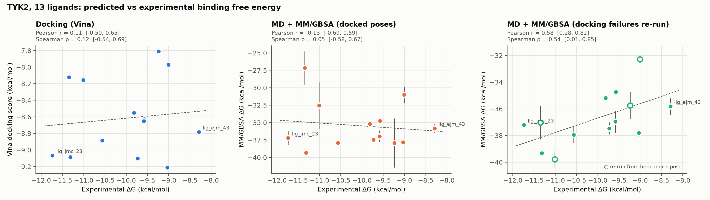
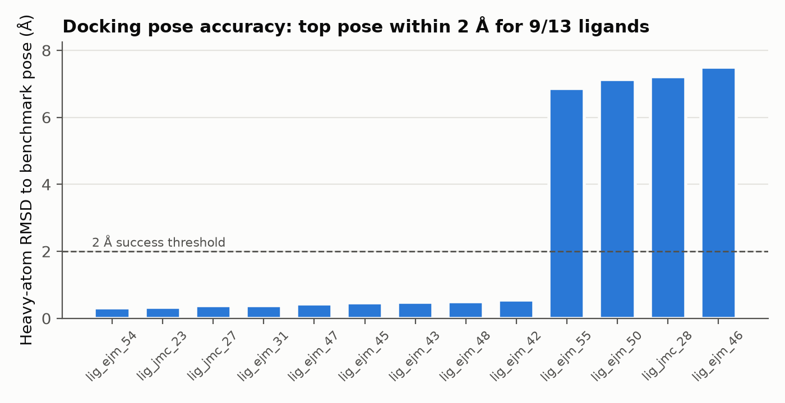

# Does MD-based rescoring beat docking scores? A TYK2 benchmark

**Question:** for a congeneric kinase inhibitor series, does running MD and rescoring with
MM/GBSA rank compounds better than the docking score alone?

<!-- ANSWER:START -->
**Answer:** _to be filled after the full run_ (see [Results](#results)).
<!-- ANSWER:END -->



---

## System

- **Target:** TYK2 kinase domain (JH1), PDB [4GIH](https://www.rcsb.org/structure/4GIH), residues 889–1178, ACE/NME capped
- **Ligands:** 13 inhibitors with measured Ki (2.5 nM – 0.84 µM, a 3.4 kcal/mol span), from the
  [OpenFF protein-ligand-benchmark](https://github.com/openforcefield/protein-ligand-benchmark)
  (MIT licence; commit in `inputs/benchmark/SOURCE_COMMIT`). This is the TYK2 set used in the
  Schrödinger FEP+ JACS 2015 benchmark.
- Experimental ΔG = RT ln Ki at 298.15 K.

## Methods

| Step | Script | What it does |
|---|---|---|
| 1 | `01_prepare_receptor.py` | Keeps the benchmark protonation (HIS → HID/HIE from explicit H); docking receptor without waters; tleap receptor with the 2 binding-site crystal waters |
| 2 | `02_parameterise_ligands.py` | GAFF2 atom types + AM1-BCC charges (antechamber), missing terms from parmchk2. antechamber's rounded charges can miss the formal charge by ~0.001 e, so the residual is spread back over the atoms (GROMACS otherwise refuses the system) |
| 3 | `03_dock.py` | AutoDock Vina 1.2 (exhaustiveness 32, 22 Å box on the binding site). Docking starts from a fresh RDKit conformer, not the crystal pose. Pose accuracy = symmetry-aware heavy-atom RMSD to the benchmark pose |
| 4 | `04_build_systems.py` | Top-ranked docked pose → ff14SB / GAFF2 / TIP3P, truncated octahedron (10 Å padding), neutralised + 0.15 M NaCl (Joung–Cheatham), converted to GROMACS with ParmEd. **Control:** ligands whose top docked pose is >2 Å from the benchmark pose are also built from the benchmark pose (`--pose reference`) and run through steps 5–6 |
| 5 | `05_run_md.py` | GROMACS: steepest-descent EM; 100 ps NVT + 1 ns NPT with heavy-atom restraints (1000 kJ mol⁻¹ nm⁻²); **3 independent 10 ns replicas** per ligand (different velocity seeds); 2 fs, h-bond constraints, PME, V-rescale, C-rescale |
| 6 | `06_mmgbsa.py` | gmx_MMPBSA 1.7, GB igb=5 with mbondi2 radii (set explicitly; the tool defaults to mbondi3), 0.15 M salt, last 5 ns of each replica every 50 ps (single-trajectory approach); per-residue decomposition for the strongest and weakest binder |
| 7 | `07_analyse.py` | Pearson r, Spearman ρ, Kendall τ with 10,000-sample bootstrap 95% CIs |

Several short replicas are used instead of one long run because MM/GBSA estimates converge
better from independent samples.

**Compute:** GROMACS 2024.3 (CUDA) on one PBS node with 2 × NVIDIA L40S. One simulation
per GPU ran at ~280 ns/day for these ~55,700-atom systems; benchmarking showed that
stacking 2–3 simulations on a GPU did not raise total throughput. The 51 production runs
(13 docked + 4 control ligands × 3 replicas) took ~24 GPU-hours per GPU. The job scripts
are in `hpc/`.

Note: the benchmark's `target.yml` lists the protein net charge as −3, but the prepared
structure's explicit hydrogens give −2 (37 Asp/Glu, 35 Lys/Arg, all His neutral). This
pipeline uses the structure as provided.

## Results

<!-- RESULTS:START -->
_Filled in by `scripts/08_launch_kit.py` from `results/summary.csv` and `results/stats.csv`._
<!-- RESULTS:END -->



## Limitations

- n = 13 compounds from one chemical series: the confidence intervals are wide, so small
  differences in r are not meaningful.
- MM/GBSA absolute values are not binding free energies (no entropy term, implicit solvent).
  Only ranking and correlation are compared.
- MD starts from the top docked pose. Where docking gets the pose wrong, MM/GBSA inherits
  that error. The third panel of Figure 1 separates the two effects by re-running the
  misdocked ligands from the benchmark pose. In a real project that pose would come from
  a crystal structure or an expert-checked binding mode.
- Alchemical FEP (Project 2) should do better on a congeneric series. This repo is the
  baseline it will be compared against.

## Reproduce

```bash
micromamba create -f environment.yml        # or conda env create -f environment.yml
micromamba activate tyk2-pl
# GROMACS >= 2022 with GPU support must be on PATH as `gmx` (or set GMX=/path/to/gmx)
./run_pipeline.sh --quick                    # 100 ps smoke test, ~minutes on a GPU
./run_pipeline.sh                            # full run: 13 ligands x 3 x 10 ns

# control for ligands docked >2 A from the benchmark pose (here: ejm_46, ejm_50, ejm_55, jmc_28)
BAD="lig_ejm_46 lig_ejm_50 lig_ejm_55 lig_jmc_28"
python scripts/04_build_systems.py --pose reference --ligands $BAD
python scripts/05_run_md.py        --pose reference --ligands $BAD
python scripts/06_mmgbsa.py        --pose reference --ligands $BAD
python scripts/07_analyse.py
```

All settings live in `config.yaml`. Each step skips finished work and MD resumes from checkpoints.
Split MD across GPUs with, for example, `python scripts/05_run_md.py --ligands lig_ejm_31 lig_ejm_42 --gpu-id 1`.

Outputs: `results/` (CSV tables), `figures/` (PNGs), `work/` (all simulation files, not tracked by git).

On a PBS cluster, `hpc/run_pbs_gpu02.pbs` runs EM → MD → MM/GBSA → analysis in one job.
It hands out one replica at a time to one worker per GPU, then runs 48 serial gmx_MMPBSA
jobs in parallel. It starts with a 2-minute gmx_MMPBSA preflight, so a broken toolchain
fails in minutes rather than after a day of MD. `hpc/bin/gmx` wraps a cluster GROMACS
build so its Intel oneAPI runtime stays out of the conda environment.

## Contact

**Ranjan Kumar**, computational biophysicist (Physics PhD researcher, BITS Pilani).
I run this kind of study as a service: protein–ligand MD, MM/GBSA, FEP, enhanced sampling.
Email: ranjankumarbijarnia70@gmail.com · Follow-up: [FEP on the same series](https://github.com/ranjan-kumar-biophys/tyk2-fep-openfe)
