<p align="center">
  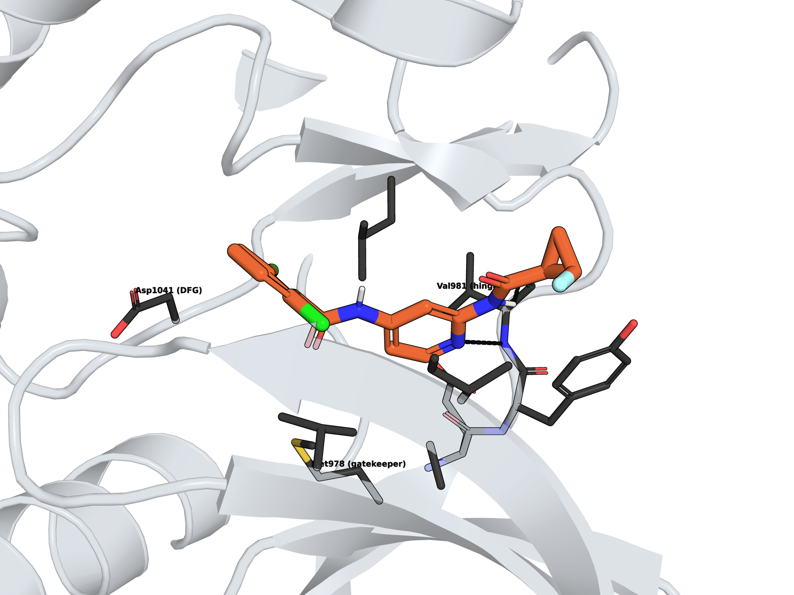
</p>

<h1 align="center">Does MD rescoring beat docking? A TYK2 kinase benchmark</h1>

<p align="center">
  
  
  
  
  
</p>

**Question:** for a congeneric kinase-inhibitor series, does running MD and rescoring with
MM/GBSA rank compounds better than the docking score alone? 13 TYK2 inhibitors with measured
Ki, 51 independent MD replicas, every number against experiment, everything open-source.

<!-- ANSWER:START -->
**Answer:** MD + MM/GBSA from the docked poses gave Pearson r = -0.13 against experiment, versus r = 0.11 for the docking score (the 95% CIs overlap, so with 13 compounds this is a trend, not a proof). Re-running the 4 misdocked ligands from the benchmark pose changed r to 0.58 (+0.71), so wrong docking poses were a large part of the MM/GBSA error. See [Results](#results).
<!-- ANSWER:END -->

<p align="center">
  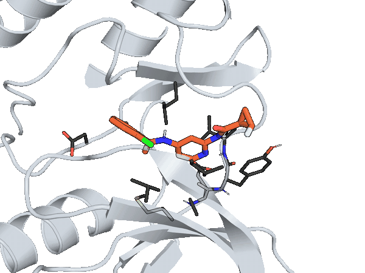
  <br><em>10 ns of MD: the strongest binder (Ki 2.5 nM) stays anchored at the kinase hinge (H-bond to Val981 in 76% of frames, mean of 3 replicas).
  Full-resolution MP4: <a href="figures/movie_lig_jmc_23.mp4">figures/movie_lig_jmc_23.mp4</a></em>
</p>

---

## Pipeline

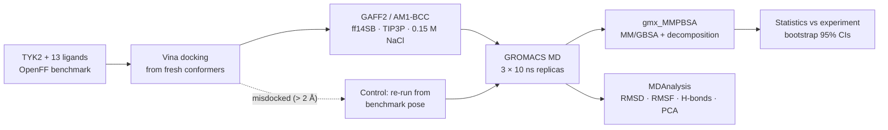

## System

- **Target:** TYK2 kinase domain (JH1), PDB [4GIH](https://www.rcsb.org/structure/4GIH), residues 889–1178, ACE/NME capped
- **Ligands:** 13 inhibitors with measured Ki (2.5 nM – 0.84 µM, a 3.4 kcal/mol span), from the
  [OpenFF protein-ligand-benchmark](https://github.com/openforcefield/protein-ligand-benchmark)
  (MIT licence; commit in `inputs/benchmark/SOURCE_COMMIT`). This is the TYK2 set used in the
  Schrödinger FEP+ JACS 2015 benchmark.
- Experimental ΔG = RT ln Ki at 298.15 K.

## Results

### 1. Ranking against experiment


<!-- RESULTS:START -->
- Vina placed 9/13 ligands within 2 Å of the benchmark pose.
- MD + MM/GBSA from the docked poses gave Pearson r = -0.13 against experiment, versus r = 0.11 for the docking score (the 95% CIs overlap, so with 13 compounds this is a trend, not a proof).
- Re-running the 4 misdocked ligands from the benchmark pose changed r to 0.58 (+0.71), so wrong docking poses were a large part of the MM/GBSA error.

| Method | Pearson r [95% CI] | Spearman ρ [95% CI] |
|---|---|---|
| Docking (Vina) | 0.11 [-0.50, 0.65] | 0.12 [-0.54, 0.69] |
| MD + MM/GBSA (docked poses) | -0.13 [-0.69, 0.59] | 0.05 [-0.57, 0.67] |
| MD + MM/GBSA (docking failures re-run) | 0.58 [0.28, 0.82] | 0.54 [0.01, 0.85] |

Docking top-pose accuracy: 9/13 within 2 Å (Figure 2).

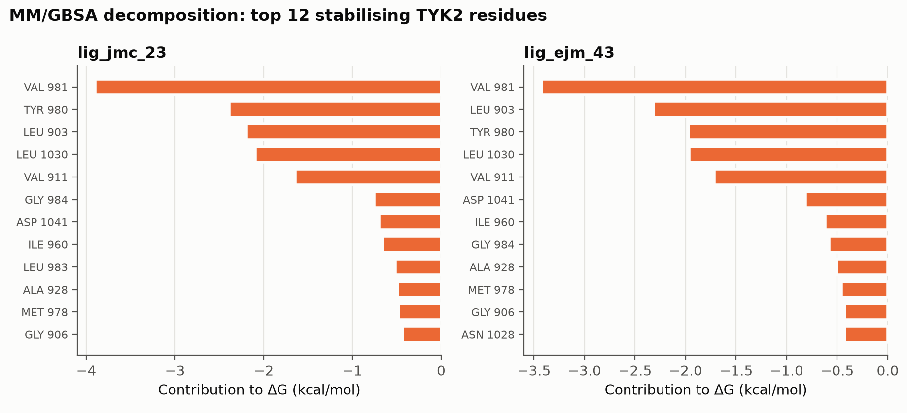

<details><summary>Per-ligand numbers (kcal/mol; Ki in nM)</summary>

| ligand | Ki_nM | dG_exp | vina_score | top_pose_rmsd_A | dG_mmgbsa | dG_mmgbsa_sem | dG_mmgbsa_ref | dG_mmgbsa_ref_sem |
|---|---|---|---|---|---|---|---|---|
| lig_ejm_31 | 96.00 | -9.57 | -8.63 | 0.39 | -34.75 | 0.24 |  |  |
| lig_ejm_42 | 64.00 | -9.81 | -8.55 | 0.54 | -35.18 | 0.12 |  |  |
| lig_ejm_43 | 840.00 | -8.29 | -8.78 | 0.48 | -35.82 | 0.62 |  |  |
| lig_ejm_45 | 94.00 | -9.59 | -8.65 | 0.47 | -36.97 | 0.83 |  |  |
| lig_ejm_46 | 4.80 | -11.35 | -8.12 | 7.50 | -27.16 | 2.38 | -37.02 | 1.26 |
| lig_ejm_47 | 74.00 | -9.73 | -9.10 | 0.44 | -37.46 | 0.45 |  |  |
| lig_ejm_48 | 240.00 | -9.03 | -9.21 | 0.50 | -37.81 | 0.27 |  |  |
| lig_ejm_50 | 250.00 | -9.01 | -7.97 | 7.12 | -30.99 | 1.16 | -32.29 | 0.59 |
| lig_ejm_54 | 18.00 | -10.57 | -8.89 | 0.31 | -37.94 | 0.63 |  |  |
| lig_ejm_55 | 170.00 | -9.23 | -7.81 | 6.86 | -37.93 | 3.53 | -35.75 | 1.01 |
| lig_jmc_23 | 2.50 | -11.73 | -9.07 | 0.33 | -37.22 | 1.00 |  |  |
| lig_jmc_27 | 5.10 | -11.31 | -9.09 | 0.38 | -39.32 | 0.11 |  |  |
| lig_jmc_28 | 8.50 | -11.01 | -8.16 | 7.21 | -32.56 | 3.34 | -39.79 | 0.61 |

</details>
<!-- RESULTS:END -->

### 2. Did docking find the right pose?


<table>
  <tr>
    <td align="center">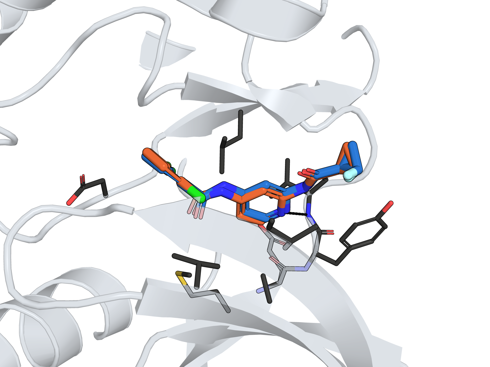<br>
      <em>lig_jmc_23: docked (blue) on the benchmark pose (orange), 0.33 Å</em></td>
    <td align="center">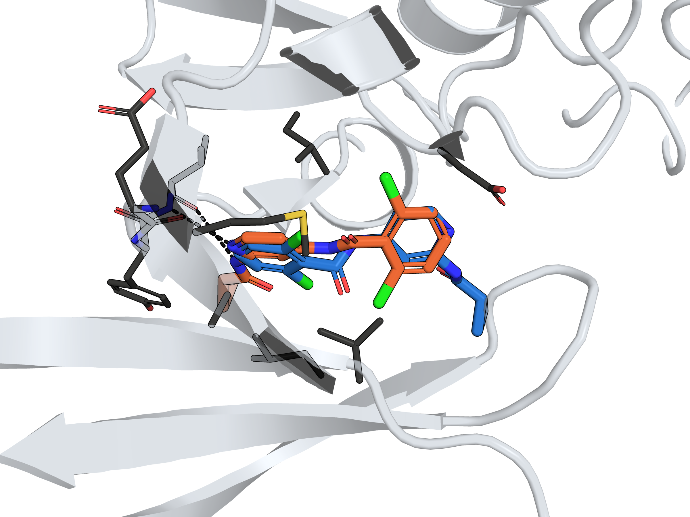<br>
      <em>lig_ejm_46: docking flips the scaffold, 7.5 Å from the benchmark pose</em></td>
  </tr>
</table>

### 3. Does MD keep, repair or lose the pose?

Every frame is superposed on the crystal structure, so the right panel measures how far each
ligand sits from its benchmark binding mode, for correctly docked, misdocked and control runs.

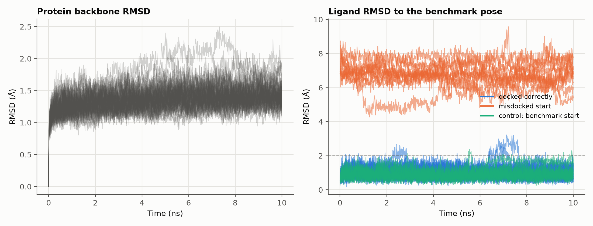

**MD did not repair a wrong pose.** Over the second half of each run, correctly docked ligands
stay within 1.6 Å of the benchmark pose, and so do the control runs started from it (≤ 1.5 Å).
All 12 misdocked replicas stay 5.9–7.7 Å away. 10 ns is too short for a ligand to leave a
wrong binding mode and find the right one, so the docking pose decides the MM/GBSA input.
The protein itself is stable (mean backbone RMSD 1.2–2.0 Å).

### 4. Binding fingerprint: who holds the ligand?

<table>
  <tr>
    <td>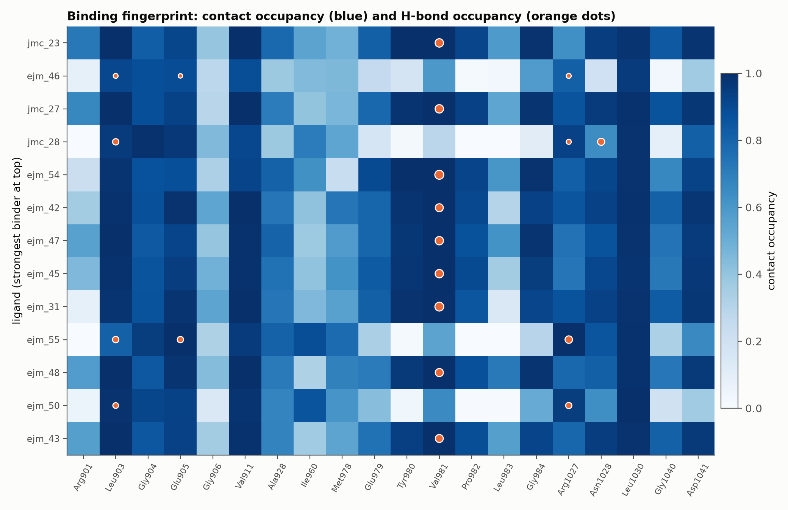</td>
    <td>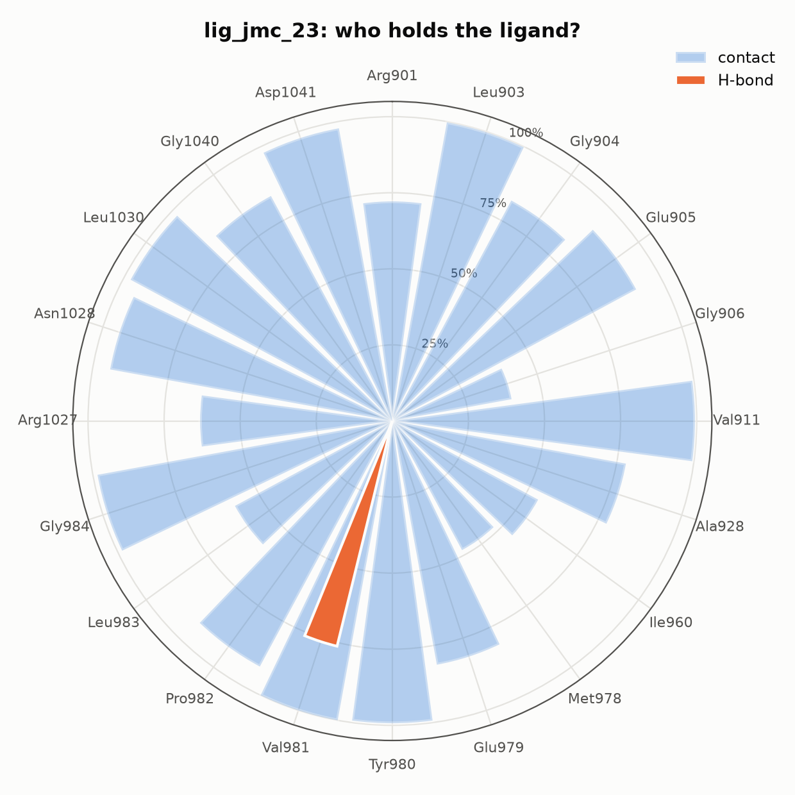</td>
  </tr>
</table>

Contact occupancy (heavy atoms within 4 Å) and H-bond occupancy per residue over all frames
and replicas, ligands ordered by measured affinity. Every correctly docked ligand H-bonds the
hinge Val981 (58–93% of frames per replica; lig_jmc_23: 76%). None of the four misdocked ligands does: they H-bond
Arg1027, Asp988 or the P-loop instead, which is the fingerprint of a wrong binding mode.

### 5. Protein flexibility and conformational landscape

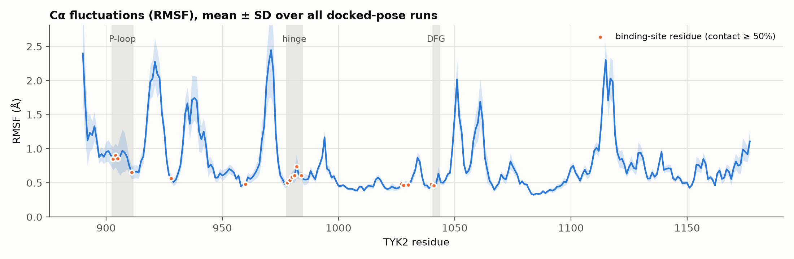

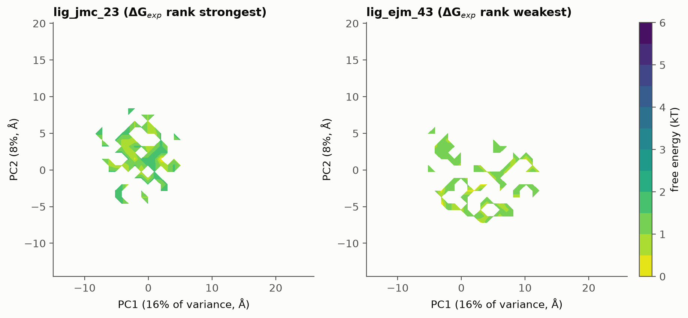

---

## Methods

| Step | Script | What it does |
|---|---|---|
| 1 | `01_prepare_receptor.py` | Keeps the benchmark protonation (HIS → HID/HIE from explicit H); docking receptor without waters; tleap receptor with the 2 binding-site crystal waters |
| 2 | `02_parameterise_ligands.py` | GAFF2 atom types + AM1-BCC charges (antechamber), missing terms from parmchk2. antechamber's rounded charges can miss the formal charge by ~0.001 e, so the residual is spread back over the atoms (GROMACS otherwise refuses the system) |
| 3 | `03_dock.py` | AutoDock Vina 1.2 (exhaustiveness 32, 22 Å box on the binding site). Docking starts from a fresh RDKit conformer, not the crystal pose. Pose accuracy = symmetry-aware heavy-atom RMSD to the benchmark pose |
| 4 | `04_build_systems.py` | Top-ranked docked pose → ff14SB / GAFF2 / TIP3P, truncated octahedron (10 Å padding), neutralised + 0.15 M NaCl (Joung–Cheatham), converted to GROMACS with ParmEd. **Control:** ligands whose top docked pose is >2 Å from the benchmark pose are also built from the benchmark pose (`--pose reference`) and run through steps 5–6 |
| 5 | `05_run_md.py` | GROMACS: steepest-descent EM; 100 ps NVT + 1 ns NPT with heavy-atom restraints (1000 kJ mol⁻¹ nm⁻²); **3 independent 10 ns replicas** per ligand (different velocity seeds); 2 fs, h-bond constraints, PME, V-rescale, C-rescale |
| 6 | `06_mmgbsa.py` | gmx_MMPBSA 1.7, GB igb=5 with mbondi2 radii (set explicitly; the tool defaults to mbondi3), 0.15 M salt, last 5 ns of each replica every 50 ps (single-trajectory approach); per-residue decomposition for the strongest and weakest binder |
| 7 | `07_analyse.py` | Pearson r, Spearman ρ, Kendall τ with 10,000-sample bootstrap 95% CIs |
| 8 | `08_launch_kit.py` | Fills this README's results and writes a one-page case-study PDF |
| 9 | `09_md_analysis.py` | MDAnalysis per replica: backbone RMSD, ligand RMSD to the benchmark pose (crystal frame), Cα RMSF, Rg, ligand–residue contact and H-bond occupancy, Cα coordinates for PCA |
| 10 | `10_render.py` | PyMOL ray-traced renders: hero image and docked-vs-benchmark pose overlays |
| 11 | `11_md_figures.py` | Stability, RMSF, binding fingerprint, rose chart, PCA free-energy landscape |
| 12 | `12_movie.py` + `12_movie_render.py` | MD movie: aligned frames → PyMOL ray-traced frames → MP4 + GIF (ffmpeg) |

Several short replicas are used instead of one long run because MM/GBSA estimates converge
better from independent samples.

**Compute:** GROMACS 2024.3 (CUDA) on one PBS node with 2 × NVIDIA L40S. One simulation
per GPU ran at ~280 ns/day for these ~55,700-atom systems; benchmarking showed that
stacking 2–3 simulations on a GPU did not raise total throughput. The 51 production runs
(13 docked + 4 control ligands × 3 replicas) took ~24 GPU-hours per GPU. The job scripts
are in `hpc/`.

Note: the benchmark's `target.yml` lists the protein net charge as −3, but the prepared
structure's explicit hydrogens give −2 (37 Asp/Glu, 35 Lys/Arg, all His neutral). This
pipeline uses the structure as provided.

## Limitations

- n = 13 compounds from one chemical series: the confidence intervals are wide, so small
  differences in r are not meaningful.
- MM/GBSA absolute values are not binding free energies (no entropy term, implicit solvent).
  Only ranking and correlation are compared.
- MD starts from the top docked pose. Where docking gets the pose wrong, MM/GBSA inherits
  that error. The third panel of Figure 1 separates the two effects by re-running the
  misdocked ligands from the benchmark pose. In a real project that pose would come from
  a crystal structure or an expert-checked binding mode.
- 10 ns replicas show local stability and contacts, not slow conformational change; the PCA
  landscape is a 2D projection of short simulations, not a converged free-energy surface.
- Alchemical FEP ([follow-up repo](https://github.com/ranjan-kumar-biophys/tyk2-fep-openfe))
  should do better on a congeneric series. This repo is the baseline it is compared against.

## Reproduce

```bash
micromamba create -f environment.yml        # or conda env create -f environment.yml
micromamba activate tyk2-pl
# GROMACS >= 2022 with GPU support must be on PATH as `gmx` (or set GMX=/path/to/gmx)
./run_pipeline.sh --quick                    # 100 ps smoke test, ~minutes on a GPU
./run_pipeline.sh                            # full run: 13 ligands x 3 x 10 ns

# control for ligands docked >2 A from the benchmark pose (here: ejm_46, ejm_50, ejm_55, jmc_28)
BAD="lig_ejm_46 lig_ejm_50 lig_ejm_55 lig_jmc_28"
python scripts/04_build_systems.py --pose reference --ligands $BAD
python scripts/05_run_md.py        --pose reference --ligands $BAD
python scripts/06_mmgbsa.py        --pose reference --ligands $BAD
python scripts/07_analyse.py

# visual layer
python scripts/09_md_analysis.py && python scripts/09_md_analysis.py --pose reference --ligands $BAD
python scripts/11_md_figures.py
pymol -cq scripts/10_render.py
python scripts/12_movie.py lig_jmc_23 1 && pymol -cq scripts/12_movie_render.py -- lig_jmc_23 1
```

All settings live in `config.yaml`. Each step skips finished work and MD resumes from checkpoints.
Split MD across GPUs with, for example, `python scripts/05_run_md.py --ligands lig_ejm_31 lig_ejm_42 --gpu-id 1`.

Outputs: `results/` (CSV tables), `figures/` (PNGs, MP4, GIF), `work/` (all simulation files, not tracked by git).

On a PBS cluster, `hpc/run_pbs_gpu02.pbs` runs EM → MD → MM/GBSA → analysis in one job.
It hands out one replica at a time to one worker per GPU, then runs gmx_MMPBSA jobs in
parallel. It starts with a 2-minute gmx_MMPBSA preflight, so a broken toolchain fails in
minutes rather than after a day of MD. `hpc/bin/gmx` wraps a cluster GROMACS build so its
Intel oneAPI runtime stays out of the conda environment.

## Contact

**Ranjan Kumar**, computational biophysicist (Physics PhD researcher, BITS Pilani).
I run this kind of study as a service: protein–ligand MD, MM/GBSA, FEP, enhanced sampling.
Email: ranjankumarbijarnia70@gmail.com · Follow-up: [FEP on the same series](https://github.com/ranjan-kumar-biophys/tyk2-fep-openfe)
